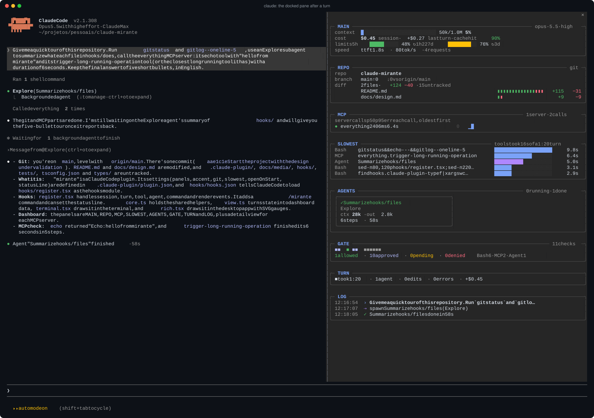
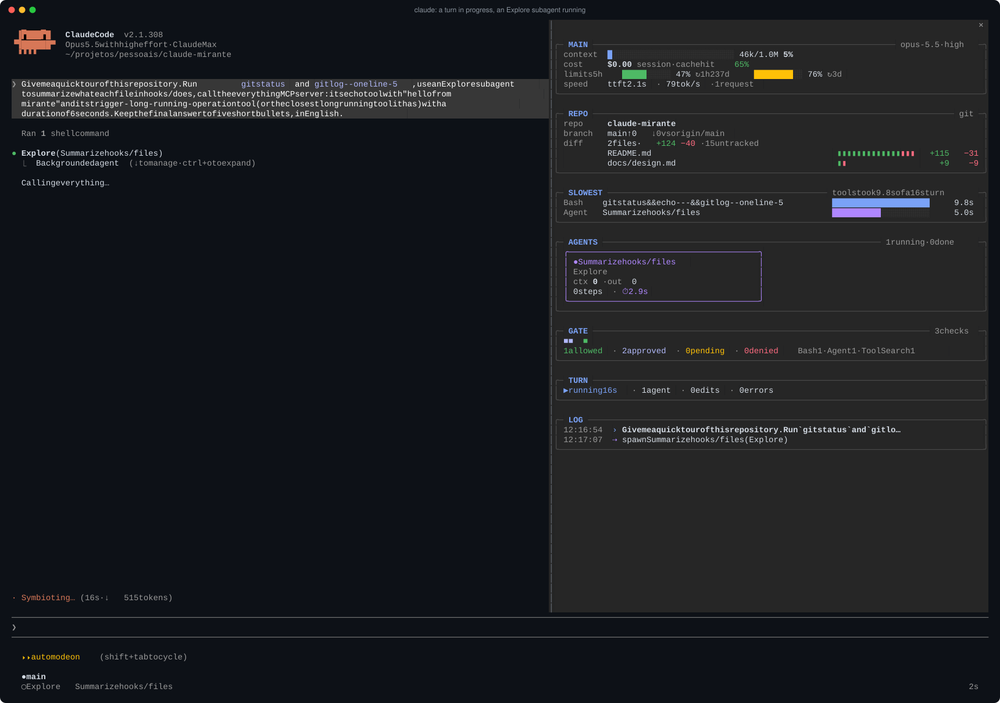
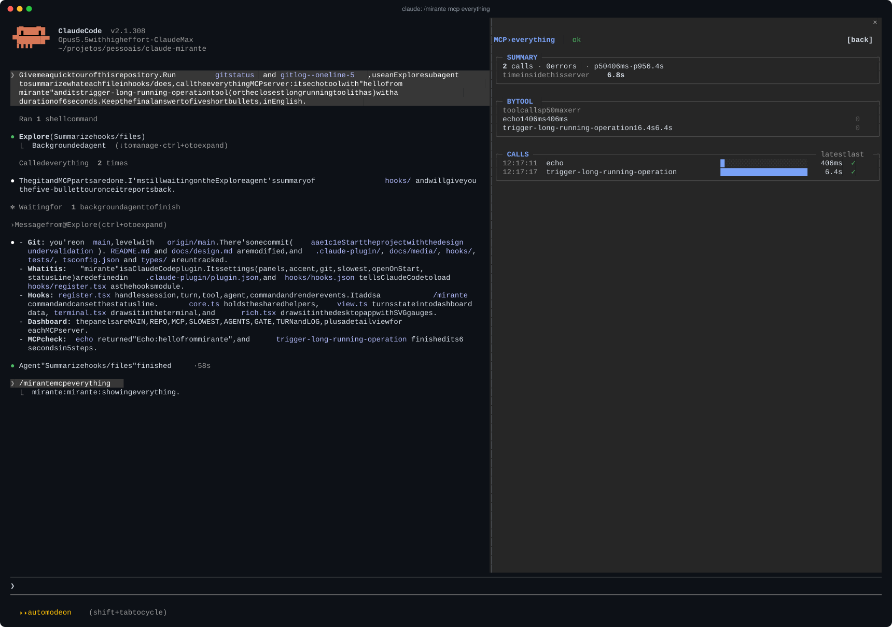
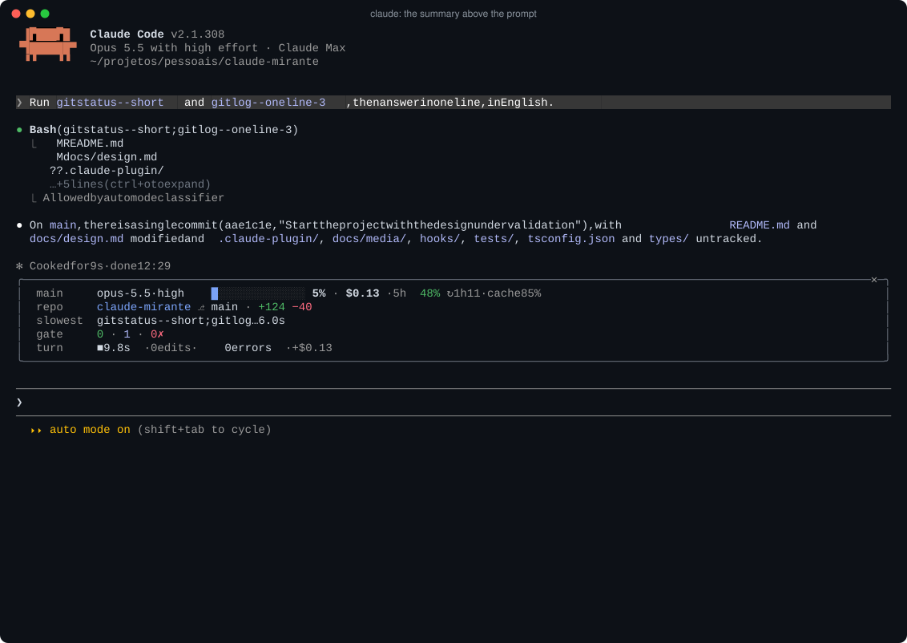
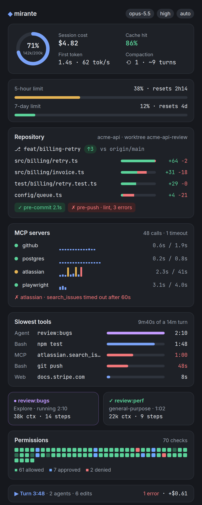
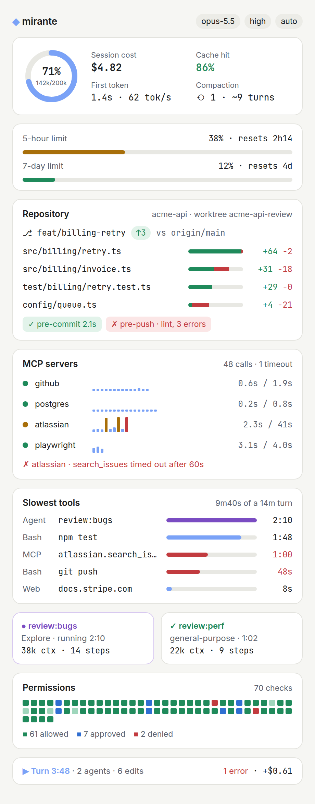

<p align="center">
  
</p>

<h1 align="center">mirante</h1>

<p align="center">
  A live session dashboard for Claude Code, in the terminal and in the desktop app.
  <br>Context, cost and limits, your repository and worktree, MCP server health,
  <br>the slowest tools, subagents, permission checks and a session log, side by side with the chat.
</p>

<p align="center">
  <a href="https://claude.com/blog/claude-code-mods"></a>
  
  
  
  <a href="LICENSE"></a>
  
</p>

<p align="center"><i>Mirante</i> is Portuguese for a lookout: the high point you climb to see everything around you.</p>

<p align="center">
  
</p>

## Install

Inside Claude Code:

```
/plugin install mirante --marketplace lsnepomuceno/claude-mirante
```

From a shell:

```sh
claude plugin install mirante --marketplace lsnepomuceno/claude-mirante
```

In the desktop app, where `/plugin` does not run: click **+** next to the prompt box, then **Plugins**, **Add marketplace** with `lsnepomuceno/claude-mirante`, then **Add plugin**.

Then open it with `/mirante`. Mods are an early access Claude Code feature; mirante was built and tested on Claude Code 2.1.308.

## Why

A Claude Code session hides most of what it does behind a spinner. When a turn takes four minutes you want to know where the time went: a test run, a subagent, an MCP server that stopped answering, a git hook that failed. mirante answers that at a glance, without leaving the session.

## What it shows

| Panel | Shows |
| --- | --- |
| **main** | model and effort; a context gauge with compactions and an estimate of the turns left before the window is full; session and last turn cost; cache hit rate; rate limit windows with their resets; time to first token and output speed |
| **repo** | the repository and worktree the shell is working in, the branch with ahead and behind counts, the files changed against the upstream with lines added and removed, untracked files and stashes, and the result of the last git hooks |
| **mcp** | one row per MCP server: calls, p50 and p95 latency, errors and a strip with every call of the session; timeouts called out on their own line; press a row (or `/mirante mcp <server>`) for the drill-down |
| **slowest** | the slowest tool calls of the session (shell commands, MCP calls, subagents, web fetches) and how long tools kept the main loop busy in the turn |
| **agents** | subagents as cards: task, type, context, output tokens, steps and a running clock |
| **gate** | one cell per permission check: allowed by a rule, approved by you or the auto mode classifier, pending or denied, with totals by tool |
| **turn** | the running or last turn: duration, agents, edits, errors and cost added |
| **log** | prompts, spawns, completions, edits, errors, denials and failed hooks, in order |

Panels with nothing to show take no room.

### In the terminal

A turn in progress, with an Explore subagent still running:

<p align="center"></p>

The MCP drill-down, one server's tools and every call:

<p align="center"></p>

Without the fullscreen layout, the pane opens above the prompt as a summary of at most eight rows:

<p align="center"></p>

The terminal images are captures of real Claude Code sessions run in this repository.

### In the desktop app

The same panels, drawn with native controls and SVG gauges, following the app theme.

<table>
  <tr>
    <td></td>
    <td></td>
  </tr>
</table>

The desktop images are rendered from the panel's design with sample data.

## Commands

| Command | Does |
| --- | --- |
| `/mirante` | open the pane (or bring it back to the dashboard) |
| `/mirante mcp <server>` | open the drill-down for one MCP server |
| `/mirante reset` | clear MCP calls, slow calls, agents, checks, the log and the turn (context, cost and limits stay) |
| `/mirante close` | close the pane |

## Configure

In `/config`, or under `pluginConfigs["mirante"].options` in `settings.json`:

| Option | Default | Meaning |
| --- | --- | --- |
| `panels` | `main,repo,mcp,slowest,agents,gate,turn,log` | which panels show, in order |
| `accent` | `blue` | `blue`, `amber`, `green` or `violet` |
| `git` | `true` | read git state for the repo panel; off hides the panel and runs no git command |
| `slowest` | `5` | how many slow calls the slowest panel lists (1 to 10) |
| `openOnStart` | `true` | open the pane when a session starts (the terminal seats it unasked only from 144 columns) |
| `statusLine` | `false` | context, cost and MCP trouble in the status line |

## Principles

- **Observe only.** Every hook passes its event on unchanged: mirante never blocks, rewrites or delays a tool call, a prompt or a subagent, and a hook that fails hands the event on as it came.
- **Local only.** No network requests, no telemetry, nothing stored past the session.
- **Measured, not guessed.** Every number comes from a session event. The one estimate, turns left before the context is full, says so.
- **Credentials masked.** Summaries of tool calls go through a redaction step (authorization headers, bearer tokens, `*_TOKEN=` style assignments, `curl -u`, passwords in URLs, common key prefixes) before they are kept.
- **Git is optional.** The repo panel runs read-only git commands (`rev-parse`, `rev-list`, `merge-base`, `diff --numstat`, `ls-files`, `stash list`), at most once per settled shell call or edit, never on a timer. Turning `git` off stops them.

## How it works

| File | Holds |
| --- | --- |
| [`hooks/register.tsx`](hooks/register.tsx) | the session hooks, the state they keep and the pane's render hook |
| [`hooks/core.ts`](hooks/core.ts) | pure functions: redaction, git and shell parsing, MCP statistics, formatting |
| [`hooks/view.ts`](hooks/view.ts) | turns the session state into what each panel shows, independent of the surface |
| [`hooks/terminal.tsx`](hooks/terminal.tsx) | the terminal drawing: the docked pane, the summary above the prompt, the MCP drill-down |
| [`hooks/rich.tsx`](hooks/rich.tsx) | the desktop drawing (also used by the editor and mobile surfaces), with SVG gauges and bars |
| [`types/index.d.ts`](types/index.d.ts) | the state contract |
| [`tests/`](tests) | pure behaviour, and the pane mounted on the terminal and the desktop |

See [docs/design.md](docs/design.md) for the layout and where each number comes from.

## Develop

```sh
git clone https://github.com/lsnepomuceno/claude-mirante
claude --plugin-dir ./claude-mirante   # the mod reloads as you save
claude plugin validate ./claude-mirante
claude plugin test ./claude-mirante
```

After the first load, Claude Code writes the API types to `.claude-plugin/types/`, and `npx -p typescript tsc -p .` type-checks the mod.

## License

[MIT](LICENSE)
